<div align="center">

# FilingLens

**Ask questions about Indian listed companies in English or Hinglish. Get answers checked against their regulatory filings.**

A full-stack, locally hosted research assistant that combines **verified XBRL data**, **hybrid RAG over annual reports** and a **local LLM** running on a 4 GB GPU. The rule that shapes the design: *the language model never produces a number.*


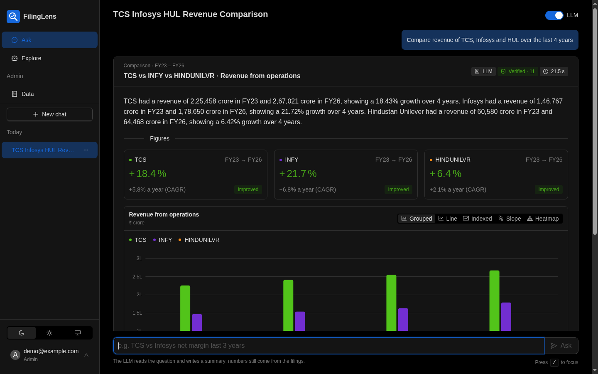

</div>

---

## Contents

- [Why I built it](#why-i-built-it)
- [What it does](#what-it-does)
- [Screenshots](#screenshots)
- [Architecture](#architecture)
- [How a question is answered](#how-a-question-is-answered)
- [RAG over annual reports](#rag-over-annual-reports)
- [Running models locally on a 4 GB GPU](#running-models-locally-on-a-4-gb-gpu)
- [Data pipeline](#data-pipeline)
- [Tech stack](#tech-stack)
- [Engineering decisions](#engineering-decisions)
- [Observability](#observability)
- [Testing and evaluation](#testing-and-evaluation)
- [Run it](#run-it)
- [Project structure](#project-structure)
- [Limitations and next steps](#limitations-and-next-steps)

---

## Why I built it

Financial numbers have to be exact. A chatbot that reads PDFs and writes "TCS earned about ₹2.5 lakh crore" can be wrong about the year, the unit, consolidated vs standalone, or simply hallucinate. Indian companies file machine-readable **XBRL** results with NSE, and publish annual reports that explain *why* the numbers moved.

FilingLens uses each source for what it is good at:

| Need | Source | How |
|---|---|---|
| Exact figures | XBRL filings | Parsed into a verified `fact` table (INR crore, fiscal periods, restatements) |
| Reasons and context | Annual-report PDFs | Chunked, indexed, searched with hybrid retrieval |
| Understanding the question | Local LLM (Qwen2.5-7B) | Picks **one validated tool call**; never writes data |
| Readable answer | Same LLM | Writes 1–5 sentences that code **checks** against the data before showing them |

## What it does

- **Figures, trends and comparisons**: "TCS revenue FY24", "Infosys net margin last 3 years", "Compare revenue of TCS, Infosys and HUL". YoY change, CAGR and derived ratios are worked out, and each fact is matched to its page in the annual report.
- **Why questions**: "Why did TCS revenue grow in FY25?" returns the change from the filings and the reasons from that year's annual report, with page citations. If the question's premise is wrong ("why did profit fall" when it rose), the answer says so.
- **Report search**: "What does Jubilant Foodworks say about store expansion?" retrieves passages with hybrid search, summarises them and cites each sentence.
- **Hinglish**: "Infosys ka diluted EPS FY23 se FY26 tak kaise badla?"
- **Conversations**: chats saved to your account and named by the LLM. Follow-ups like "and Infosys?" or "why did it grow" are read together with the previous question.
- **Explore dashboard**: KPI cards, indexed growth, ratio radar, revenue-to-profit waterfall, group share, ratio heatmaps.
- **Admin data console**: all 2,635 NSE-listed companies; download filings to S3, ingest them, and run GPU or CPU embedding jobs with live progress.
- **Works without the LLM**: a rule-based planner answers the same questions when the model is off, paused or wrong.

**Current data:** 11 companies, 4,384 filed facts (FY23 to FY27 Q2), 29 annual reports, 36,684 searchable passages.

## Screenshots

<table>
  <tr>
    <td width="50%"><b>Why question: figures plus cited reasons</b><br>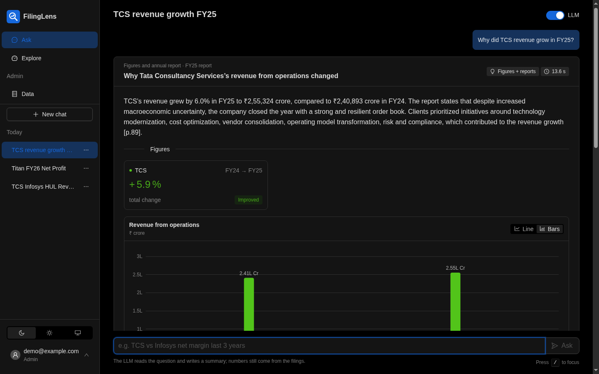</td>
    <td width="50%"><b>Report passages with page, section and highlights</b><br>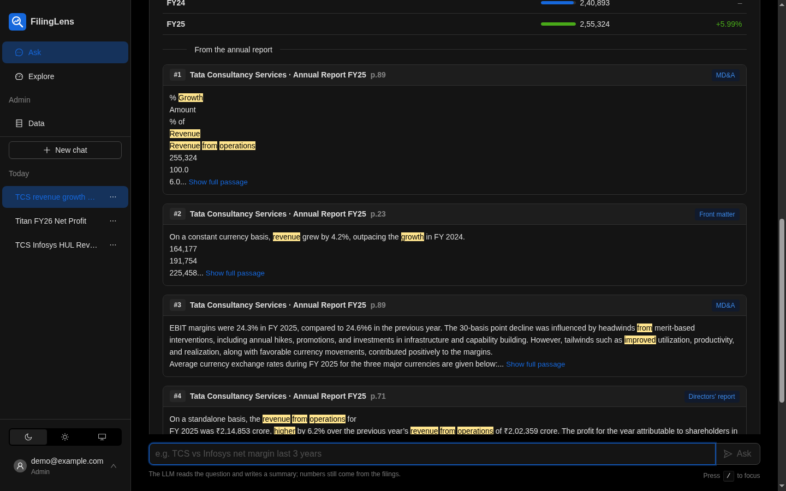</td>
  </tr>
  <tr>
    <td><b>Report search (RAG) with page citations</b><br>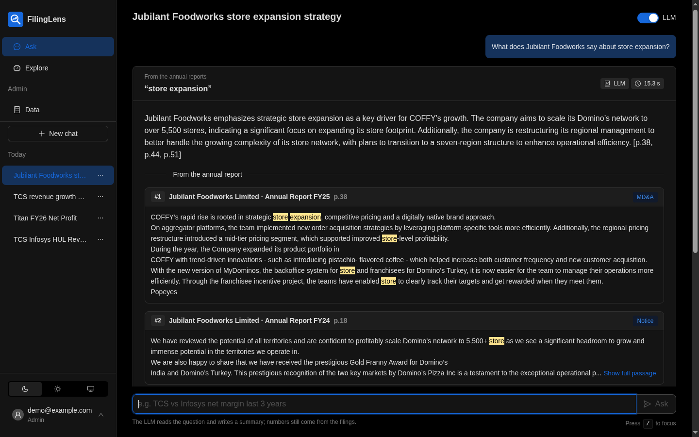</td>
    <td><b>Single figure: history and verified source</b><br>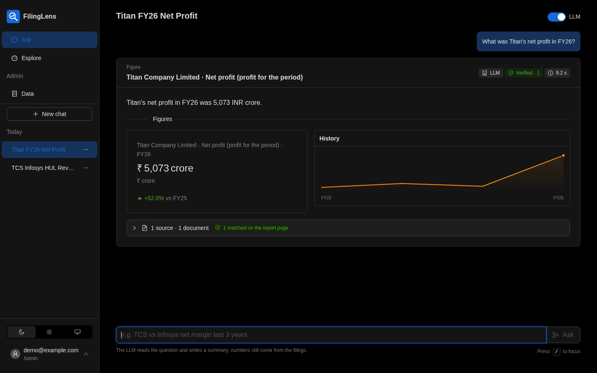</td>
  </tr>
  <tr>
    <td><b>Follow-up read with the previous question</b><br>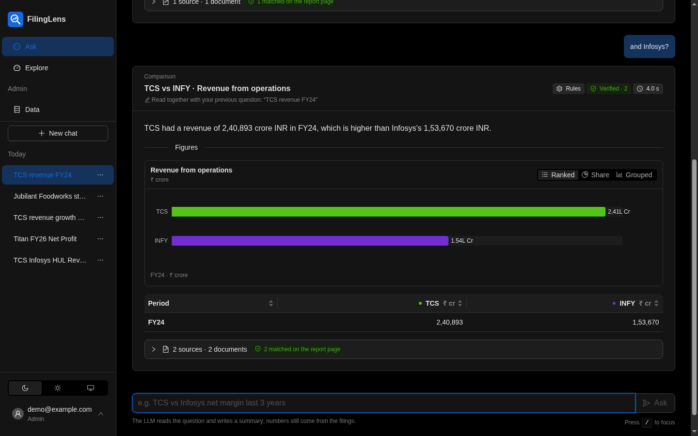</td>
    <td><b>Hinglish question, trend with CAGR</b><br>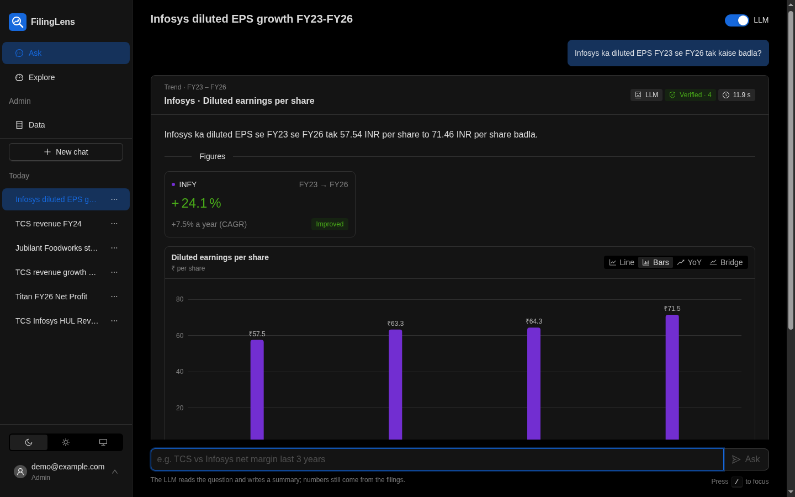</td>
  </tr>
  <tr>
    <td><b>Explore dashboard</b><br>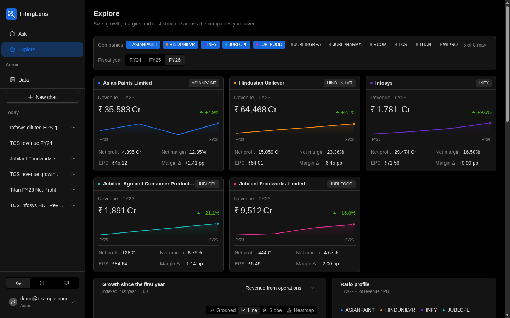</td>
    <td><b>Indexed growth, ratio radar, waterfall, share</b><br>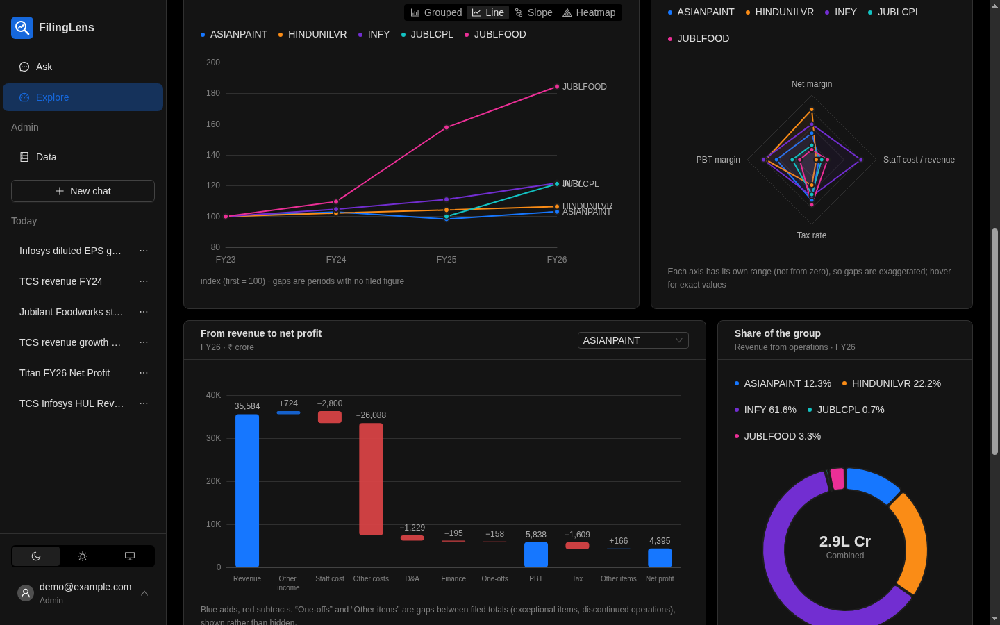</td>
  </tr>
  <tr>
    <td><b>Admin: filings, S3 and embedding status</b><br>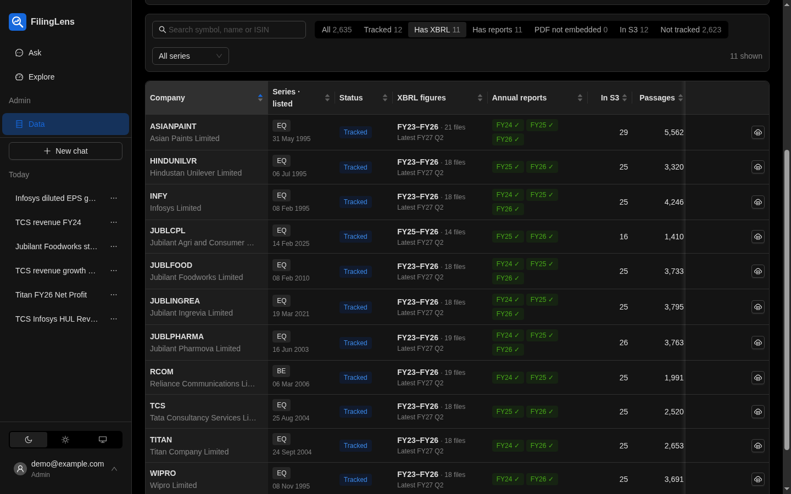</td>
    <td><b>Light theme</b><br>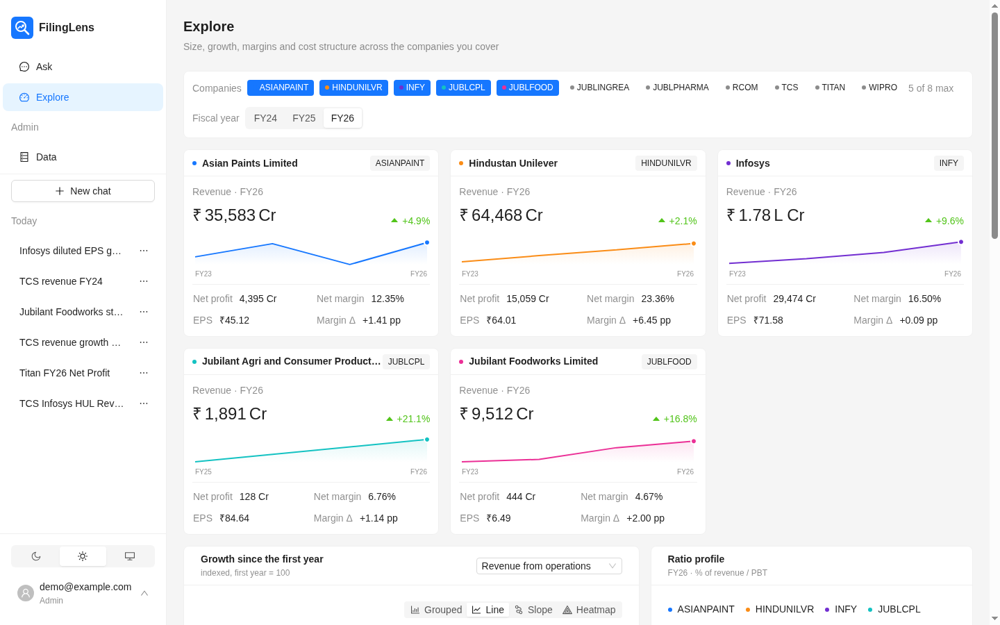</td>
  </tr>
  <tr>
    <td><b>Landing page</b><br>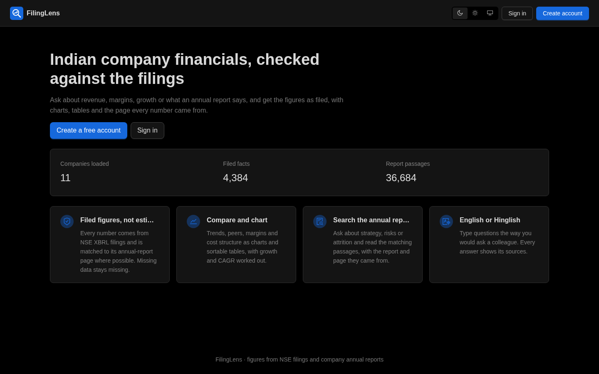</td>
    <td align="center"><b>Mobile</b><br>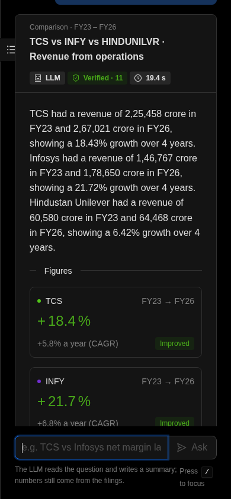</td>
  </tr>
</table>

---

## Architecture

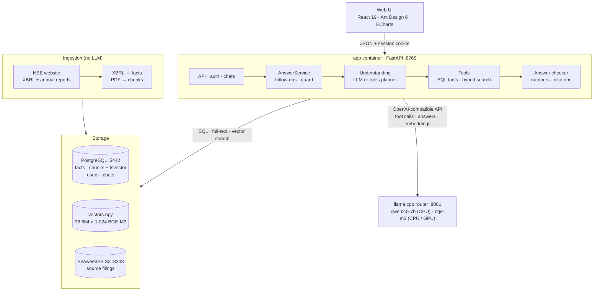

Everything runs on one machine with `docker compose up`: five services, every port bound to `127.0.0.1`, secrets in `.env`.

| Service | Image | Port | Role |
|---|---|---|---|
| `postgres` | postgres:18.7 | 5442 | Facts, report passages with full-text index, users, sessions, chats |
| `seaweedfs` | chrislusf/seaweedfs | 8333 | S3-compatible store: durable copy of every downloaded filing |
| `s3manager` | cloudlena/s3manager | 8090 | Web UI for the bucket |
| `llm` | llama.cpp `server-cuda` | 8081 | One router serving the chat model and the embedding model |
| `app` | built from `Dockerfile` | 8765 | FastAPI API + the built React app |

## How a question is answered

The LLM is used for exactly two jobs: **turn the question into one tool call**, and **write a short answer from the tool's result**. Everything around it is deterministic code.

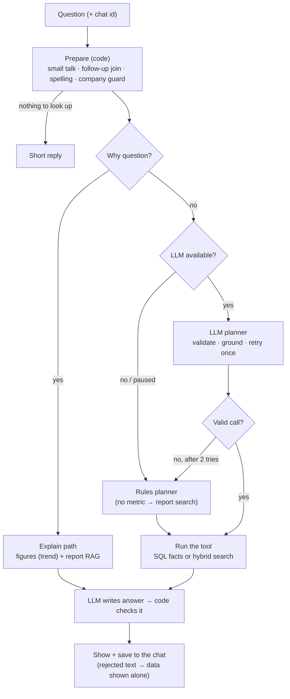

**Five tools**, with JSON schemas generated from `registry.yaml` so the allowed companies and metrics always match the data:

| Tool | Does |
|---|---|
| `get_value` | One fact: company, metric, fiscal year or quarter, consolidated/standalone |
| `get_trend` | A series with YoY change and CAGR |
| `compare` | Up to 8 companies × 5 metrics, raw, indexed (first year = 100) or as a share |
| `search_reports` | Hybrid search over annual-report passages |
| `ask_user` | A clarifying question |

**Guard rails around a 7B model.** Small models make predictable mistakes, and each one has a check in code:

| Model mistake | Fix |
|---|---|
| Swaps an uncovered company (Wipro) for a covered one (Infosys) | **Grounding**: every ticker in the call must be named in the question |
| Invalid or misspelled arguments | **Pydantic validation**, forgiving where the meaning is clear ("Infosys" → INFY, "2023-24" → FY24); the exact error goes back for **one retry** |
| Prints the tool call as text | `parse_text_call` accepts `<tool_call>{…}</tool_call>` |
| Two tool calls for a joined follow-up | Follow-ups joined by code are planned by the **rules** |
| Refuses a covered company, or searches PDFs for a figure | The rules see a known company and metric → **use the checked data instead** |
| Wrong fiscal quarter for "September 2026 quarter" | The calendar decides (Q2 FY27); the model's guess is overridden |
| Invents a number in the written answer | **Checker**: every number must appear in the evidence (rounding allowed); cited pages must be retrieved; no company outside the data |

## RAG over annual reports

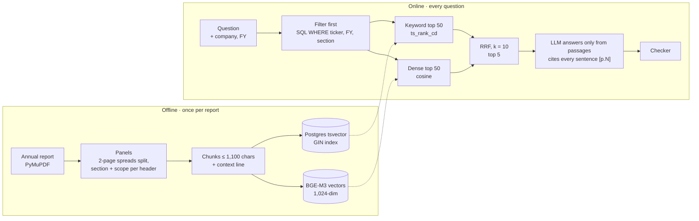

- **Chunks carry metadata**: each one is embedded with a context line such as `Infosys | Annual Report FY26 | mdna | scope: consolidated | page 82`. This lets "TCS FY25 MD&A" match on metadata and tells the model where a passage came from.
- **Filters before ranking**: company, year and section are applied in SQL before either retriever ranks anything, so a TCS question can never retrieve Infosys text.
- **Reciprocal Rank Fusion** merges the keyword and vector lists by rank (`1 / (k + rank)`), so scores from different retrievers never need calibrating.
- **Tuned on a golden recall set** (11 questions worded differently from the report):

| Setup | Recall@5 |
|---|---|
| Dense only | 8/11 |
| Keyword only | 8/11 |
| Hybrid, RRF k = 60, all words | 7/11 |
| **Hybrid, stopwords dropped (English + Hinglish), RRF k = 10** | **9/11** |

  Naive hybrid was *worse* than either retriever alone: common words matched hundreds of chunks, and chunks ranked mid-way in both lists beat a strong #1 from one list. Dropping stopwords and a smaller `k` fixed it.

- **Why questions combine both stores.** "Why did TCS revenue grow in FY25?" fetches the FY24→FY25 change from the facts table. It then searches that year's report, management discussion first, using the direction the data shows (not the one the question assumes). The model explains with cited reasons, and code checks every number.

> **Why no LangChain, LangGraph or vector database?** The flow is fixed and short (one tool call, one answer), and its correctness depends on checks between the steps. Writing it directly against the OpenAI-compatible API keeps every step visible and testable with a fake LLM. With 37k vectors, a filtered NumPy dot product takes milliseconds. pgvector with an HNSW index, or an agent framework, would be the next step at larger scale or with multi-step agents.

## Running models locally on a 4 GB GPU

One **llama.cpp router** (`llm/models.ini`) serves three model presets behind one OpenAI-compatible endpoint:

| Preset | Model | Device | Used for |
|---|---|---|---|
| `qwen2.5-7b` | Qwen2.5-7B-Instruct, Q4_K_M GGUF | GPU (partial offload) | Tool calling, answers, chat titles |
| `bge-m3-cpu` | BGE-M3, Q8_0 GGUF | CPU | Embedding each question (~50 ms) |
| `bge-m3-gpu` | same file | GPU | Bulk embedding of reports (~41 passages/s) |

The chat model and bulk embedding can't share 4 GB of VRAM, and they're never needed at the same time:

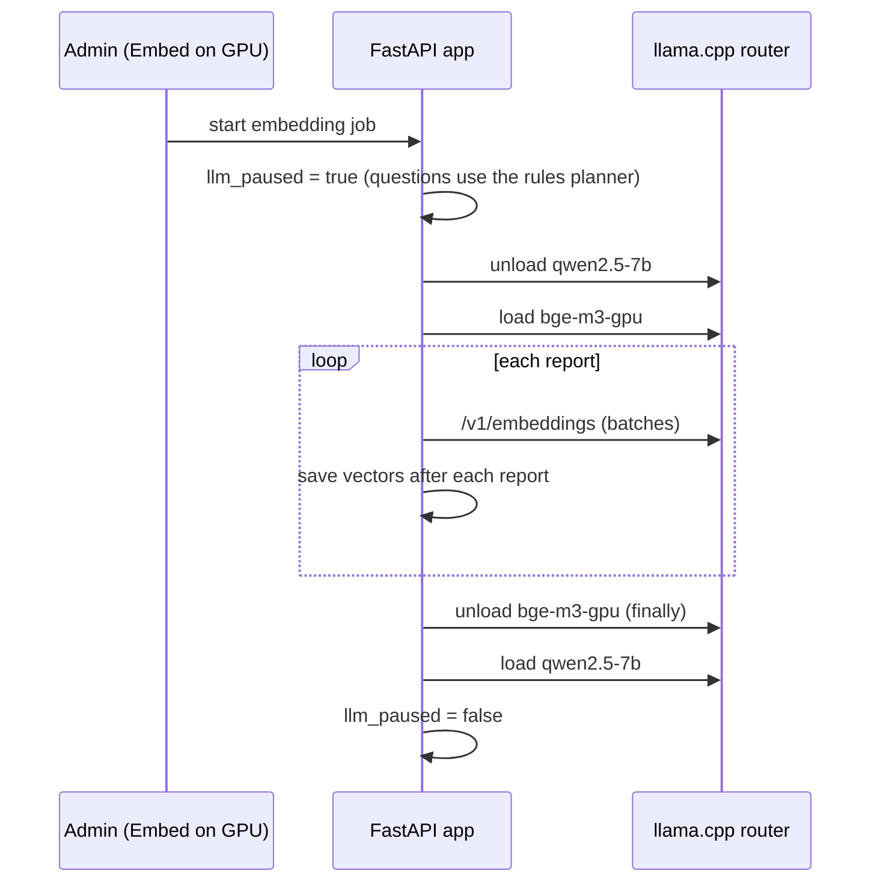

Other tuning that mattered:
- **One llama.cpp slot (`parallel = 1`)** keeps the ~3.7k-token system prompt warm in the KV cache. With several slots, requests often landed on a cold slot and spent ~7 s re-processing the prompt.
- **CLS pooling** for BGE-M3, which the converted GGUF doesn't set by default.
- **Small, fast builds**: models are mounted read-only from `~/models` and never baked into an image. The app image has no PyTorch (1.0 GB), and uv and npm cache mounts make a code-only rebuild take about 4 s.

## Data pipeline

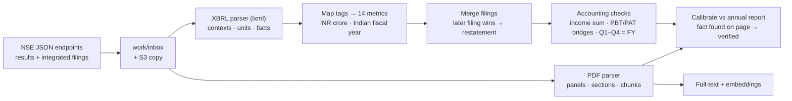

- **No LLM in ingestion.** Everything is deterministic and re-runnable. Documents are keyed by the SHA-256 of their content, so re-ingesting is idempotent.
- **XBRL quirk handled.** In NSE result files, the year-to-date context carries the quarter's dates. The parser restores the real period from `DateOfStartOfReportingPeriod`, otherwise full-year facts would collapse into Q4.
- **Facts are traceable**: each one keeps its source filing, its page in the annual report, a `verified` flag and a `qa` flag from the accounting checks.
- **Derived ratios** (net margin, PBT margin, effective tax rate, employee cost ratio) are computed on read, never stored.

## Tech stack

| Layer | Technology |
|---|---|
| Backend | Python 3.14, FastAPI, Pydantic v2, psycopg 3, uv |
| Auth | fastapi-users (database sessions, HttpOnly cookie), argon2 password hashing, admin/user roles |
| Data | PostgreSQL 18 (full-text search, generated `tsvector` + GIN), SeaweedFS (S3), boto3 |
| Parsing | lxml (XBRL, inline XBRL), PyMuPDF (annual reports) |
| LLM serving | llama.cpp router (CUDA), Qwen2.5-7B-Instruct Q4_K_M, BGE-M3 Q8_0, OpenAI Python SDK |
| Retrieval | Hybrid: Postgres full-text + NumPy dense vectors, Reciprocal Rank Fusion |
| Frontend | React 19, TypeScript, Vite 6, Ant Design 6, Apache ECharts 5 |
| Infra | Docker Compose, NVIDIA Container Toolkit, multi-stage builds with BuildKit cache mounts |
| Quality | pytest + Hypothesis, ruff, mypy, ESLint, `tsc`, Ant Design's lint |

## Engineering decisions

| Decision | Why | Trade-off |
|---|---|---|
| The LLM routes; SQL returns the numbers | Figures must be exact and traceable | Only questions the 5 tools can express get numbers |
| A rules planner next to the LLM | Works with no GPU, during embedding jobs, or when the model errs | Synonyms and patterns need upkeep |
| Small local model (7B, 4-bit) | Free, private, runs on a laptop GPU | Needed validation, grounding, retries and overrides |
| Checks on numbers and citations, not a judge model | Deterministic and fast; no invented figure reaches the user | Doesn't catch a wrong "higher than" claim when the numbers themselves are right |
| Hybrid search with RRF | Keyword catches exact terms (BRSR, tickers); vectors catch meaning and Hinglish | Two retrievers to tune |
| NumPy vectors and Postgres full-text | No extra services; filters stay in SQL | Linear scan; fine at tens of thousands of chunks |
| CPU embeddings for questions | The chat model keeps the GPU | ~50 ms per question on CPU |
| One DB connection behind a lock | Simple and race-free for a local app | Requests are serialised |

## Observability

Every question leaves a **trace** in Postgres (`ask_trace`), with no extra services:
- the route it took and why;
- each planner attempt, with the exact validation or grounding error;
- the search query, filters, keyword and dense rankings, and the fused passages;
- every LLM call with prompt, completion and **KV-cache tokens** (from llama.cpp's `timings`);
- the answer checker's verdict and reason;
- the time of every step.

It's recorded through a small context-variable tracer (`trace.py`), so deep code adds steps without passing a trace object around. Saving never fails a request.

**Admin → Traces** shows:
- questions per day;
- the share answered by the LLM;
- the fallback rate, the answer-rejection rate and the reasons;
- p50 and p95 time;
- the prompt-cache hit rate;
- p50 and p95 time per step type.

Each trace opens as a step waterfall with every step's details. `filinglens eval` writes one trace per question tagged with its run, so a failed case shows exactly which step went wrong. `filinglens traces --show ID` prints a trace in the terminal, and `--prune 30` deletes traces older than 30 days.

## Testing and evaluation

- **395 offline tests** (`pytest`, ~35 s): parsing, units, fiscal calendar, fact merging, validation, both planners, follow-ups, the LLM loop, answer checks, API routes, auth, chats and the GPU swap order. Each test gets its own Postgres schema.
- **Fakes instead of mocks**: `FakeLLM` replays scripted replies and records every request. A tiny fake llama.cpp HTTP server tests the model swap sequence.
- **Retrieval recall set** (`pytest -m embed`): recall@5 on real annual-report questions.
- **End-to-end evaluation** (`filinglens eval`): 61 questions scored on the right tool, arguments, values, cited page, correct refusals, no number when data is missing, and **zero fabricated numbers**. Runs in rules or LLM mode, and saves runs to JSON for comparison.

## Run it

**Requirements:** Docker with the NVIDIA Container Toolkit, and two GGUF files in `~/models`: `Qwen2.5-7B-Instruct-Q4_K_M.gguf` and `bge-m3-Q8_0.gguf`.

<details>
<summary>Converting BGE-M3 to GGUF (once)</summary>

```bash
docker run --rm -u "$(id -u):$(id -g)" -e HOME=/tmp -v /path/to/bge-m3:/model:ro -v ~/models:/out \
  --entrypoint python3 ghcr.io/ggml-org/llama.cpp:full-b12110 /app/convert_hf_to_gguf.py /model \
  --outtype q8_0 --outfile /out/bge-m3-Q8_0.gguf
```
</details>

```bash
cp .env.example .env                       # set passwords and keys
docker compose up -d --build               # postgres, seaweedfs, s3manager, llm, app
docker compose exec app filinglens companies --refresh          # NSE's list of listed companies
docker compose exec -it app filinglens users create-admin you@example.com
```

Open **http://127.0.0.1:8765**, sign in, and add companies from **Admin → Data** (Download), then embed their reports there.

<details>
<summary>Command line</summary>

```bash
uv sync --extra dev --extra api --extra llm
filinglens download TCS INFY HINDUNILVR     # XBRL results + annual reports → work/inbox
filinglens ingest work/inbox                # facts, checks, report pages, PDF verification
filinglens index                            # embeddings for report search
filinglens ask "TCS vs Infosys net margin"  # add --no-llm for the rules planner
filinglens trend INFY net_margin
filinglens search "attrition" --ticker TCS --section mdna
filinglens eval --mode rules                # score answers on evals/questions.yaml
filinglens serve                            # API + UI on :8765, docs at /docs
```
</details>

<details>
<summary>HTTP API</summary>

| Endpoint | Returns |
|---|---|
| `POST /ask` `{"question", "use_llm", "chat_id"}` | Written answer + data view, saved to a chat |
| `GET /value` · `/trend` · `/compare` · `/search` | Direct tool calls, no LLM |
| `GET /chats` · `GET/PATCH/DELETE /chats/{id}` | Your chats |
| `POST /auth/register` · `/auth/login` · `/auth/logout` · `GET /auth/me` | Accounts |
| `GET /admin/companies` · `POST /admin/companies/{symbol}/download` · `/admin/embeddings` | Admin: NSE downloads, ingest, embedding jobs |
| `GET /admin/traces` · `/admin/traces/stats` · `/admin/traces/{id}` | Admin: request traces and their stats |

Every response is a typed Pydantic model. Interactive docs at `/docs`, schema at `/openapi.json`.
</details>

<details>
<summary>Development</summary>

```bash
docker compose up -d postgres              # tests need Postgres
uv sync --extra dev --extra api --extra llm
pytest                                     # each test gets an empty schema
cd web && npm install && npm run dev       # UI on :5173, proxies the API on :8765
```
</details>

## Project structure

```
src/filingLens/
├── service.py          # AnswerService: the one path every question takes (API, CLI, eval)
├── llm/                # client (OpenAI-compatible), planner loop, tools, prompt, answer checker
├── nlu/                # rules planner, follow-ups, spelling correction
├── retrieval/          # hybrid search (RRF), vector index, embedders
├── analytics/          # trends, comparisons, derived ratios
├── ingest/             # XBRL parser, PDF parser, validation, calibration
├── storage/            # Postgres schema and repositories, S3 store
├── api/                # FastAPI app, auth, chats, admin, embedding jobs
├── chats.py            # chat store and titles
├── trace.py            # request traces (Admin → Traces)
└── acquire.py          # NSE downloader
web/src/                # React + Ant Design + ECharts UI
llm/models.ini          # llama.cpp router presets
evals/questions.yaml    # end-to-end evaluation set
tests/                  # 395 tests, golden data, recall set
```

## Limitations and next steps

- **Re-ranking**: a cross-encoder over the top 20 passages, and each metric's usual drivers added to why-question searches.
- **Claim checking**: verify "higher / lower / grew / fell" against the table, not only the numbers.
- **Follow-ups that replace a metric** ("what about revenue" after a margin question) instead of adding one.
- **Streaming answers** over Server-Sent Events.
- **Scale**: a connection pool, async database access, and pgvector with HNSW for millions of chunks.
- **Banks and NBFCs** file with a different XBRL taxonomy, so most of the 14 metrics are missing for them.

---

<div align="center">
Built with FastAPI, PostgreSQL, llama.cpp and React. Data from public NSE filings.
</div>
